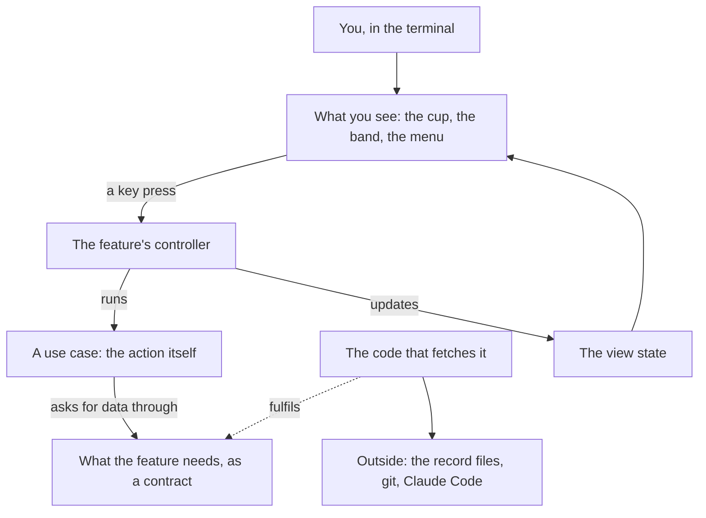
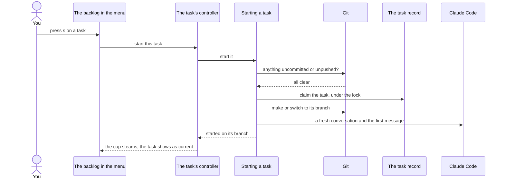
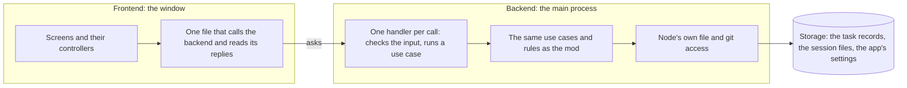

# Queue-tea architecture

- **Date:** 2026-10-28
- **State:** agreed with Rohan, not built. The restructure of `hooks/` follows the plan written after this; the app in `app/` takes the same shape when it's built.
- **Why:** the repository's rule that "the architecture fits the size of the part, and its layers stay apart". What the user sees and the business rules live apart, for the mod, the app's frontend and backend, and the storage.

Queue-tea is built **feature-first, with three layers per feature**, the same shape as Gait-feedback's `mobile/lib/`. Inside a feature it is **MVVM**:

| MVVM | Here | Its job |
|---|---|---|
| View | a view in `presentation/views/` (`.tsx`) | draws state and forwards key presses |
| ViewModel | the feature's controller in `presentation/state_management/` | runs use cases and exposes state, as a Riverpod Notifier or a BLoC Cubit would |
| Model | `domain/` and `data/` | the rules, the use cases, and where the data comes from |

## 1. The shape of the mod

```
hooks/
├── register.tsx              the plugin's entry: builds each feature's providers, mounts the app
├── app/                      what composes the features: the menu frame, the band's host, the session's rhythm
├── core/                     app-wide: env/, host/ (files and processes), ports/ (the engine, as one object), store/ (the view state), logger/, session/
├── shared/<resource>/        used by two or more features; same shape as a feature
└── features/<feature>/
    ├── data/                 datasources/  repositories/  constants/
    ├── domain/               entities/  repositories/  usecases/  services/  constants/
    ├── presentation/         views/  state_management/  widgets/  constants/
    └── <feature>_providers.ts
```

| Piece | What it does |
|---|---|
| Data source | Talks to one outside thing: the record files, git, Claude Code. Returns raw values and throws on failure. |
| Repository impl | Calls data sources and maps their results to entities. The only code that knows a data source. |
| Repository interface | The contract the rest of the feature sees, in `domain/`. Speaks entities only. |
| Entity | A plain, immutable type. No Claude Code types, no file paths read or written. |
| Use case | One action: start a task, block one, write a handoff note. It calls repository interfaces and returns a result; it never touches view state. |
| Service | Pure rules a use case or controller needs: ranking, a branch name, the cup's mood. |
| Controller | The ViewModel. Runs use cases, holds the feature's view state in the store, and names its loading, partly loaded, done, empty and failed states with a union type. |
| View | Draws the controller's state with Claude Code's UI and calls the controller on a key press. |
| Providers file | `<feature>_providers.ts` builds the repositories, use cases and controller. The only place that names an `*Impl`, so a test can swap it. |

## 2. Rules

1. **Dependencies point inwards.** `presentation` and `data` depend on `domain`; `domain` depends on nothing. No Claude Code, files or processes in `domain`.
2. **Views and controllers never touch `data/`.** No Claude Code file or process call, no `*Impl`, outside `data/`, `core/` and the providers files.
3. **A feature never imports another feature.** What two features need moves to `shared/<resource>/`. Only `app/` and `register.tsx` put features together. `shared/` may use other `shared/` resources and `core/`, never a feature. `core/` imports nothing from `features/` or `app/`, and from `shared/` only entity types.
4. **Use cases don't touch view state.** They return what happened; the controller turns it into what the user sees.
5. **One use case per action.** A repository interface lives in `domain/`, its implementation in `data/`.
6. **Only `core/`, `data/` folders, views and widgets, `app/` and `register.tsx` import `claude-code`.** Controllers don't: what they need from the engine comes through `Ports`.
7. **`tools/check_layers.mjs` checks rules 1, 2, 3 and 6 from the imports.** It also finds import cycles, and a cup `module` path that names no file. It's a Node script run with `node tools/check_layers.mjs`, because a mod's tests can't read files: their runner allows only relative imports and `claude-code`.

## 3. The layers, in a picture



The arrows show who calls whom. The dotted arrow is the one that points back in: the code that fetches data fulfils a contract the feature wrote, so the rules never depend on files, git or Claude Code.

| In the picture | In the code |
|---|---|
| What you see | `features/*/presentation/views/`, `app/` |
| The feature's controller | `features/*/presentation/state_management/<feature>_controller.ts` |
| A use case | `features/*/domain/usecases/` |
| A contract | `features/*/domain/repositories/`, `shared/*/domain/repositories/` |
| The code that fetches it | `features/*/data/`, `shared/*/data/` |
| The view state | `core/store/` |

## 4. Pressing Start, step by step



If git isn't clear, "Starting a task" comes back with the reason, nothing is claimed and no branch is made, and the controller shows the git hold.

| In the picture | In the code |
|---|---|
| The backlog in the menu | `features/tasks/presentation/views/backlog_view.tsx` |
| The task's controller | `features/tasks/presentation/state_management/tasks_controller.ts` |
| Starting a task | `features/tasks/domain/usecases/start_task.ts` |
| Git | `shared/git/` |
| The task record | `shared/records/` |
| Claude Code | `shared/assistant/` |

## 5. Features, shared resources and the core

### Features

| Feature | What it covers | Built from today's |
|---|---|---|
| `tasks` | filing, the backlog, the ★, priorities, Play next, blocking, sagas and chapters, remove, move, the active feature; Start with the git check, the current task, Done with the task log, Back to queue, switching, drift and lines | `flow.ts`: `startTask`, `fileTask`, `finishTask`, `finishDocs`, `putBack`, `blockTask`, `unblockTask`, `togglePlayNext`, `removeQueued`, `moveTask`, `setFeature`, `featureCommand`, `switchToTask`, `continueTask`, `taskLooksDone`, `taskSection`, `refreshDrift`, `refreshLines`; `docslog.ts`; their presses in `actions.ts`; the Backlog, Current task, Blocked… and Part of… views; the file, difficulty and docs path bands |
| `message_check` | sorting each message; the can't-tell band; holding and sending | `check.ts`; `flow.ts`: `onMessage`, `shouldCheck`, `sendHeld`, `dropHeld`; their presses; the unsure band |
| `conversation` | what happens after a turn past the size or the allowance mark; the 5-hour allowance; Usage & time | `flow.ts`: `afterTurn`; `usage.ts`; the Usage & time view |
| `history` | History and the week's figures | the week figures in `ui/status.ts`; the History view |
| `errands` | /brew and /tea | `errand.ts`; `actions.ts`: `errandFor`, `sendErrand`, `brewNow`, `giveBack`; the Brew view |
| `commit_guard` | refusing Claude's commits and pushes, and the warning when one appears anyway | `guard.ts`; `flow.ts`: `commitWarning` |
| `tea_cup` | the cup and its mood, the status line | `ui/cup.ts`, `ui/teacup.tsx`, `statusText` from `ui/status.ts`, `readCup` and `refreshStatus` from `ports.ts` |
| `settings` | the Settings view | the Settings view in `ui/menu.tsx` |

`queue` and `task_cycle` are one feature because they can't be two: the Backlog and Current views share Blocked…, Part of… and the active feature, and filing a task can start it.

### Shared resources

| Resource | What it holds | Built from today's |
|---|---|---|
| `shared/records/` | the JSON records, our database: the entities, the queue's basic rules, the records repository, the file data source (lock, `.bak`, carry-over), and the controller that loads, changes and restores the record | `record.ts`, `queue.ts`, the model types in `types/index.d.ts`; `flow.ts`: `change`, `markUnreadable`; `actions.ts`: `loadRecord` |
| `shared/backlog/` | ranking, the ★, blocking rules, families of tasks | `plan.ts`, `family.ts` |
| `shared/git/` | git facts, branches, diffs, the hold reason, branch names | `git.ts` |
| `shared/assistant/` | Claude Code as a helper: the repository for forking, clearing and submitting; the fresh conversation; writing a handoff note | `flow.ts`: `checkNow`, `freshConversation`, `isStartingFresh`, `writeHandoff` |
| `shared/checkpoints/` | reading and writing checkpoints and handoff notes, and the note a card shows | `checkpoint.ts`, `ui/handoff.ts`, `firstObject` from `check.ts` |
| `shared/effort/` | the tracker counting each turn's work, and writing it to the record | `effort.ts`; `actions.ts`: `flush` |
| `shared/time/` | days, offsets, durations, the allowance's type | `time.ts`, `formatAge` from `ui/status.ts` |

### The core and the app

| Folder | What it holds | Built from today's |
|---|---|---|
| `core/env/` | the plain types everything shares: the context, the options, the clock, ids and the log | `Ctx` and `Options` in `types/index.d.ts` |
| `core/host/` | the file and process seam (`Host`) and its Claude Code source | `host.ts` |
| `core/ports/` | the engine as one object, `Ports`, and how it's built from Claude Code | `Ports` in `flow.ts`, `portsOf` in `ports.ts`, `Ask` and `askOf` in `check.ts` |
| `core/store/` | the view state every controller writes and every view reads; the band's queue; opening and closing the menu | the atoms in `ports.ts`; `flow.ts`: `showBand`, `closeBand`; `actions.ts`: `openMenu`, `closeMenu`, `menuClosed` |
| `core/logger/` | one logger for the whole mod | `debug` in `ports.ts` |
| `core/session/` | the options and the session's context, held for the session; a run at a time per key | `readOptions`, `live.ts`; `once` in `flow.ts` |
| `core/widgets/` | `cut`, the menu's keys, and what every menu view is drawn with | `cut` in `ui/status.ts`, `ui/keys.ts`, the shared helpers in `ui/menu.tsx` |
| `app/menu/` | the menu frame, its failed and loading states, the routes between the views, Help | the frame of `ui/menu.tsx`, `toggleMenu` and `pressMenu` |
| `app/band/` | the band's host: the cup, then whichever feature's question is up | `ui/band.tsx` |
| `app/session/` | the session's rhythm, which crosses features: start, each turn's end, the tick, a /clear, restoring a record | `register.tsx`: `startSession`, `afterEachTurn`; `session.ts`: `loadContext`; `actions.ts`: `tick`, `afterClear`, `saveBeforeClear`, `pressRestore`, `checkResume` |
| `register.tsx` | the hooks, tools and commands, in today's order | `register.tsx` |
| `types/index.d.ts` | only the plugin's state declaration for Claude Code | the same file, without the model types |

## 6. The app: frontend, backend and storage

The workspace app (`app/`, specified in `workspace-app.md`) takes the same shape on both sides, and uses the mod's `shared/` and `features/*/domain` as its engine.



```
app/
├── main/                     the backend
│   ├── core/                 a Node host (fs/promises, execFile), logger, settings, the records watcher
│   ├── features/<feature>/api/   one handler per call: validates input, runs the use case, returns data or an error
│   └── main.ts               windows, menus, and the providers that wire it all
├── preload/                  hands the API to the window
└── renderer/                 the frontend
    ├── app/                  the root and the router
    ├── config/routing/routes.ts   every route
    ├── core/                 api/ (the one base file for replies), constants/, widgets/ (panel, chip, HUD, sky, dragon)
    ├── l10n/                 every string the user reads
    └── features/<screen>/    data/ (its API calls), domain/, presentation/ (pages, state_management, widgets)
```

- **Screens are features:** `home`, `quests`, `chronicle`, `mana`, `hoard`, `guild_hall`, `settings`, plus the moments each screen opens (start, judgement, done, seal, move).
- **The game rules** (XP, levels, stages, streak, gold, badges) are a `game` feature's `domain/services`, pure functions over the records, so the backend works them out and the frontend only draws them.
- **Storage is only the files** there today: the records in `~/.queue-tea/projects`, the session files in `~/.queue-tea/sessions`, and the app's settings in Electron's `userData`. There is no other database.
- The app imports `shared/` and `features/*/domain` from the mod, never a mod view or Claude Code.

## 7. Tests

- The mod's tests move to `tests/unit/<feature>/` and `tests/unit/shared/<resource>/`, with views' tests in `tests/view/<feature>/`. `claude plugin test .` still finds every `*.test.ts(x)`.
- A test fakes a repository through the feature's providers, or builds the real one over the in-memory host in `tests/helpers.ts`, as today.
- `node tools/check_layers.mjs` reads every import under `hooks/` and fails on a broken rule from section 2. Its own tests run with `node --test tools/`.
- The app's tests are `*.spec.ts(x)` under `app/`, run with Vitest, so the mod's test run never picks them up.

## 8. Getting there

The restructure changes where code lives and who calls whom, never what Queue-tea does. It happens in a git worktree, because the installed mod runs from this folder: this folder changes only when the whole branch is ready. Every step leaves `claude plugin test .`, the type check, `claude plugin validate .` and `node tools/check_layers.mjs` passing, and the tests keep their assertions: they change their imports. `docs/plan-feature-first.md` has the steps. In order:

1. The layer check, the entities, the pure rules, `core/` and the shared resources.
2. One feature at a time, smallest first: `commit_guard`, `errands`, `tea_cup`, `history`, `settings`, `conversation`, `message_check`, `tasks`. Each takes its use cases out of `flow.ts`, its presses out of `actions.ts` and its view out of `ui/menu.tsx`.
3. `app/` takes the menu frame, the band's host and the session's rhythm. `flow.ts`, `actions.ts`, `ports.ts`, `live.ts` and `ui/` are gone by the end.
4. `CLAUDE.md`'s folder table and `workspace-app.md`'s "Where the code lives" come into line with this document.

## 9. Not part of the restructure

These rules from `CLAUDE.md` apply to code as it's next changed, not in this move: one `AppError` type for user-facing failures, constants and localisation files for the mod's text, and the app's dev, stage and prod flavors (the app isn't built yet).
